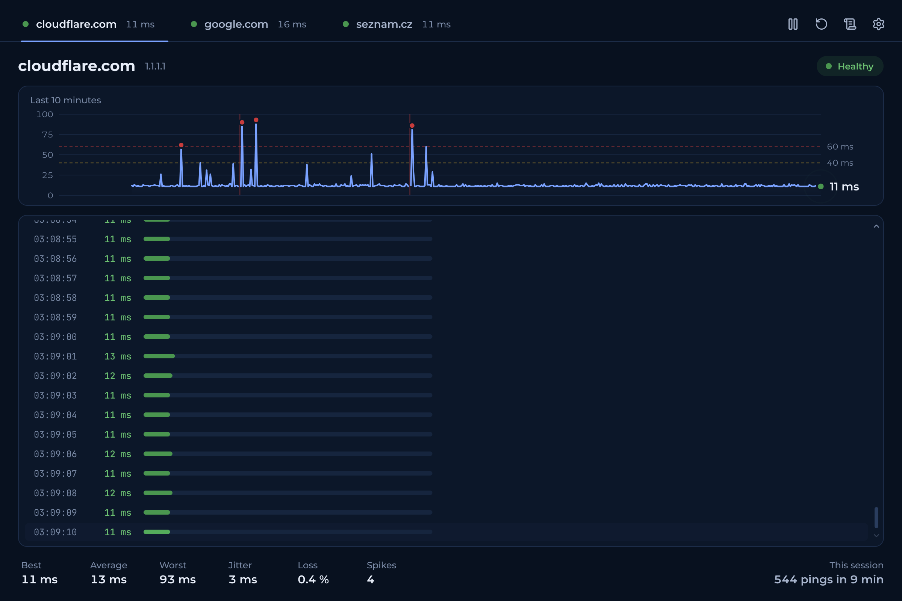

# 📊 Ping Monitor


A ping monitor that sits in your system tray and keeps an eye on your connection. It pings several servers at once, draws a live latency chart for each of them and tells you the moment your internet starts acting up. Perfect for gamers and anyone who wants to know when the connection is the problem.



## ✨ Features

- 📈 **Live view per server**
  - A tab for every server with a health dot and its latest ping
  - Latency chart (the preserved window, at most the last hour) with threshold lines, spikes, lost pings and gaps; hover it for exact values
  - The ping stream: one row per ping, colored by latency, with a small bar so spikes stand out
  - Best, average, worst, jitter, packet loss and spikes, plus session totals
- 🔔 **Tray icon**
  - Green (healthy), yellow (degraded), red (failing) or grey (waiting for pings), based on the **first** server
  - Tooltip with the latest ping of every server, left click shows or hides the window
  - Optional Windows notification when the first server starts failing and when it is healthy again (see below)
- 🩺 **Health rules** (last 5 minutes; a lost ping counts as above both thresholds)
  - 🟢 Healthy: fewer than 3 pings above the healthy threshold or lost
  - 🟡 Degraded: 3 or more pings above the healthy threshold or lost
  - 🔴 Failing: 3 or more pings above the degraded threshold or lost
- 🎯 **Accurate measuring**
  - Native Windows ICMP (the same API `ping.exe` uses), no console windows, no admin rights
  - All servers are pinged in parallel on a fixed clock grid, so timestamps never drift or skip
  - A ping that takes longer than 90 % of the interval (between 0.5 and 4 s) counts as lost; at 1 s that is 900 ms
  - If Windows freezes or sleeps, the stream shows an explicit "No samples for X s" row instead of silently missing pings
- 📝 **Ping spikes log**
  - Every spike and lost ping is recorded, split into **Current session** and **Previous sessions** (last 24 hours), newest first
  - Crash safe: an unexpectedly closed session is archived on the next start
  - The lists show the newest 20,000 entries; everything stays in the log files
- ⚙️ **In-app config**: servers (with automatic IP lookup), thresholds, interval, preserved minutes, close to tray, notifications, background picture, start with Windows
- 🎨 **Modern UI**: dark theme with Montserrat, smooth fades instead of flashes, scales up in full screen
- 🪟 **One instance**: starting the app again just brings the running window to the front

## 🛠️ Installation

1. Install [Python 3.14](https://www.python.org/downloads/) or newer.
2. Clone or download this repository.
3. Run `setup.bat`. It creates the `venv` folder, installs the dependencies from `uv.lock` (only PySide6) and offers to start the app.
4. Start the app any time with `run.vbs` (no console window). For the taskbar, create a shortcut with the target `wscript.exe "C:\path\to\ping-monitor\run.vbs"` and pin that (a `.vbs` file itself cannot be pinned).

## 📖 Usage

- The window shows one tab per server. Pings start right away and keep running when the window is closed to the tray.
- Hover the chart to read exact values. Scroll the stream with the mouse wheel (it speeds up with long histories); the arrows of the scrollbar jump to the top or the bottom, and **Latest** brings you back to live updates.
- Select rows in the stream or in the logs and press `Ctrl+C` to copy them.
- The reset button offers **Reset current tab** and **Reset all tabs**.
- Right-click the tray icon for **Show**, **Hide**, **Close to tray** and **Exit**.

| Shortcut | Action |
|---|---|
| `Ctrl+1` … `Ctrl+9`, `Ctrl+Tab`, `Ctrl+Shift+Tab` | Switch server tabs |
| `Ctrl+,` | Open config |
| `Ctrl+L` | Open logs |
| `Ctrl+R` | Reset the current tab |
| `Ctrl+P` | Pause or resume pinging |
| `End` | Jump to the latest ping (when the stream has the focus) |
| `Esc` | Close the open panel |

While a panel (Config, Logs, a question) is open, `Tab` stays inside it and the other shortcuts do nothing until it is closed (`Esc` closes it).

### Notifications

- "*server* is failing" once per incident, at most every 5 minutes. If the server keeps having problems after those 5 minutes, the notification comes then.
- "*server* is healthy again" when its health is back to green and its last lost ping or spike is at least a minute old, so a connection that flaps around the limit does not keep notifying.
- Lost pings and spikes in the first minute after the app starts or the PC wakes from sleep (Wi-Fi is often still reconnecting) and in the 30 seconds after you save the config never cause a "failing" notification; problems that go on after that still do.

## ⚙️ Configuration

Click the gear icon (or press `Ctrl+,`). Hover the ⓘ icons for the allowed values.

| Setting | Default | Meaning |
|---|---|---|
| Servers | cloudflare.com, google.com, seznam.cz | 1–10 servers: a name (a domain such as `cloudflare.com`) and an IPv4 address. Enter in the name looks the IP up when the IP is still empty. A new IP must answer a ping before it is saved. |
| Ping Threshold Healthy | 40 ms | Pings up to this value are green (1–999). |
| Ping Threshold Degraded | 60 ms | Pings above it are spikes: red and logged (1–999, at least the healthy threshold). |
| Ping Interval | 1 s | Seconds between pings (1–60). |
| Preserved Minutes | 10 | How much history each tab keeps (1–999, or `-1` for everything until you close the app, at most 200,000 pings per server). |
| Close To Tray | on | The close button hides the window to the tray instead of quitting. |
| Notifications | on | Windows notifications about the first server (see above). |
| Background Image | off | The blue picture behind the app instead of the plain background. |
| Start With Windows | off | Start in the tray when you sign in. |

Settings are saved to `logs/app_config.json` (the format of older versions still loads). Start With Windows is the `PingMonitor` entry under `HKCU\Software\Microsoft\Windows\CurrentVersion\Run`; switching it off in Task Manager or in Settings › Apps › Startup is respected. If you move the app's folder, start it once with `run.vbs` and the entry is repaired.

## 📂 Files

Everything else the app writes lives in the `logs` folder (the **Open log folder** button in the logs panel opens it):

- `app_config.json` – settings
- `ping_spikes_current.log` – spikes of the running session
- `ping_spikes.log` – previous sessions (24 hours)
- `app.log` – app events and errors (rotated)
- `ui_state.json` – window size, position and last tab

## 🐞 Troubleshooting

- **The app does not start**: run `setup.bat` again; a missing dependency is reported in a message box. Details are in `logs/app.log`.
- **No window appears**: it may already be running in the tray (started with Windows or closed to the tray); click the tray icon or start it again.
- **Tray icon missing**: check the notification area settings of Windows (hidden icons).
- **Every ping times out**: check the firewall (ICMP echo) and your connection.
- **No samples for X s rows**: Windows did not let the app run during that time (sleep, heavy load). The ping values themselves are still correct.

## 🧑‍💻 Development

```bash
uv sync                      # includes the dev dependencies (pytest); needs uv installed
uv run pytest                # core + offscreen UI tests
```

- `PING_MONITOR_SIMULATE=1` uses simulated pings (handy on Linux/WSL or without a network).
- `PING_MONITOR_DATA_DIR=<folder>` stores settings and logs somewhere else (use it with simulated pings, so fake spikes never reach your real logs).
- Code layout and conventions are described in [AGENTS.md](AGENTS.md).

## 📜 Credits

- License: MIT, see [LICENSE](LICENSE)
- UI: [PySide6](https://doc.qt.io/qtforpython-6/) (LGPLv3)
- Fonts: [Montserrat](https://github.com/JulietaUla/Montserrat) and [JetBrains Mono](https://github.com/JetBrains/JetBrainsMono) (SIL Open Font License 1.1, see `assets/fonts`)
- Icons: [Lucide](https://lucide.dev) (ISC; the icons derived from Feather are MIT, see `assets/icons/LICENSE-lucide.txt`)
